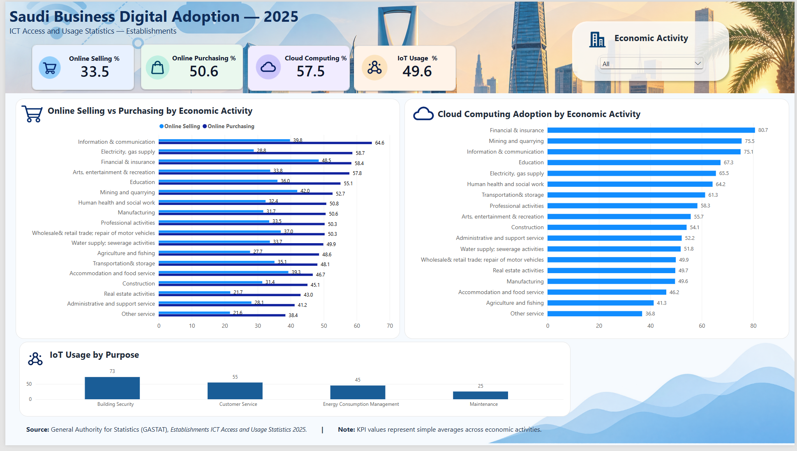
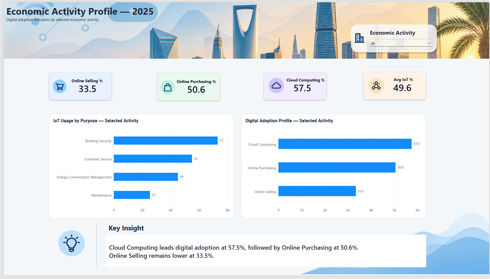

# Saudi Business Digital Adoption — 2025
## تحليل تبني الأعمال للتقنيات الرقمية في السعودية — 2025



---

## العربية

### نبذة عن المشروع
مشروع **Saudi Business Digital Adoption 2025** هو مشروع تحليل بيانات باستخدام **Power BI** يهدف إلى استكشاف مستوى تبني التقنيات الرقمية لدى المنشآت في المملكة العربية السعودية.

يعتمد المشروع على بيانات رسمية من **الهيئة العامة للإحصاء (GASTAT)** ضمن **Establishments ICT Access and Usage Statistics 2025**، ويركز على مؤشرات البيع عبر الإنترنت، الشراء عبر الإنترنت، الحوسبة السحابية، واستخدام إنترنت الأشياء (IoT) حسب الغرض والنشاط الاقتصادي.

### أهداف التحليل
يهدف المشروع إلى:
- مقارنة مستوى التبني الرقمي بين الأنشطة الاقتصادية.
- تحديد الأنشطة الأعلى في استخدام الحوسبة السحابية.
- مقارنة البيع والشراء عبر الإنترنت.
- تحليل استخدام إنترنت الأشياء لأغراض أمن المباني، خدمة العملاء، إدارة استهلاك الطاقة، والصيانة.
- توفير صفحة تفاعلية لتحليل كل نشاط اقتصادي بشكل منفصل.

### الأدوات
- Power BI
- Power Query
- DAX
- Excel
- GitHub

### خطوات العمل
1. استيراد ملف GASTAT Excel.
2. اختيار الجداول 21 و23 و25 و27.
3. تنظيف البيانات في Power Query.
4. إزالة صفوف العناوين والمصدر والإجمالي.
5. توحيد أسماء الأعمدة واللغة.
6. تحويل جدول IoT من Wide إلى Long باستخدام Unpivot.
7. بناء نموذج بيانات مشترك باستخدام Economic Activities.
8. إنشاء Measures باستخدام DAX.
9. تصميم صفحتين تفاعليتين في Power BI.
10. توثيق المنهجية والبيانات والـDAX في GitHub.

### صفحات الـDashboard

#### 1. Executive Overview
تعرض:
- Online Selling %
- Online Purchasing %
- Cloud Computing %
- Avg IoT Usage %
- مقارنة البيع والشراء حسب النشاط الاقتصادي
- الحوسبة السحابية حسب النشاط الاقتصادي
- استخدام IoT حسب الغرض

> **ملاحظة:** بطاقات KPI تعرض المتوسط الحسابي البسيط عبر 18 نشاطًا اقتصاديًا، وليست بالضرورة مساوية لصف Total الرسمي في المصدر.

#### 2. Economic Activity Profile
صفحة تفاعلية تسمح باختيار نشاط اقتصادي واحد وتحليل:
- Online Selling
- Online Purchasing
- Cloud Computing
- Average IoT Usage
- IoT Usage by Purpose
- Digital Adoption Profile
- Dynamic Key Insight



### مصدر البيانات
**General Authority for Statistics (GASTAT)**  
**Establishments ICT Access and Usage Statistics 2025**

Official website: https://www.stats.gov.sa/


---

## English

### Project Overview
**Saudi Business Digital Adoption 2025** is a **Power BI data analytics project** exploring digital technology adoption among establishments in Saudi Arabia.

The project uses official data from the **General Authority for Statistics (GASTAT)** from the **Establishments ICT Access and Usage Statistics 2025** publication. It focuses on online selling, online purchasing, cloud computing adoption, and Internet of Things (IoT) usage by purpose and economic activity.

### Analytical Objectives
The project aims to:
- Compare digital adoption across economic activities.
- Identify economic activities with the highest cloud-computing adoption.
- Compare online selling and online purchasing patterns.
- Analyze IoT usage for building security, customer service, energy consumption management, and maintenance.
- Provide an interactive sector-level profile for detailed exploration.

### Tools
- Power BI
- Power Query
- DAX
- Excel
- GitHub

### Workflow
1. Imported the official GASTAT Excel workbook.
2. Selected Tables 21, 23, 25, and 27.
3. Cleaned and transformed data in Power Query.
4. Removed non-data title, source, blank, and total rows.
5. Standardized column names and language.
6. Unpivoted the IoT table from wide to long format.
7. Built a shared Economic Activities dimension.
8. Created DAX measures.
9. Designed two interactive Power BI report pages.
10. Documented the methodology, DAX, data dictionary, and transformations for GitHub.

### Dashboard Pages

#### 1. Executive Overview
Includes:
- Online Selling %
- Online Purchasing %
- Cloud Computing %
- Avg IoT Usage %
- Selling vs Purchasing by Economic Activity
- Cloud Computing Adoption by Economic Activity
- IoT Usage by Purpose

> **Important:** KPI cards represent simple unweighted averages across the 18 economic activities. They are not necessarily equal to the official source Total row.

#### 2. Economic Activity Profile
An interactive page for a selected economic activity showing:
- Online Selling
- Online Purchasing
- Cloud Computing
- Average IoT Usage
- IoT Usage by Purpose
- Digital Adoption Profile
- Dynamic Key Insight

### Data Source
**General Authority for Statistics (GASTAT)**  
**Establishments ICT Access and Usage Statistics 2025**

Official website: https://www.stats.gov.sa/

---

## Repository Structure

```text
Saudi_Business_Digital_Adoption_2025_GitHub/
├── START_HERE_BEFORE_UPLOAD.md
├── README.md
├── .gitignore
├── dashboard/
│   └── Saudi_Business_Digital_Adoption_2025.pbix   ← add this
├── data/
│   ├── raw/
│   │   └── README.md
│   └── processed/
│       ├── online_selling.csv
│       ├── online_purchasing.csv
│       ├── cloud_computing.csv
│       ├── iot_usage_by_purpose.csv
│       ├── digital_adoption_by_activity.csv
│       └── dashboard_kpi_reference.csv
├── images/
│   ├── 01_executive_overview.png
│   └── 02_economic_activity_profile.png
├── assets/
│   ├── icons/
│   └── backgrounds/
├── documentation/
│   ├── data_cleaning_ar_en.md
│   ├── data_model_ar_en.md
│   ├── dax_measures_ar_en.md
│   ├── data_dictionary_ar_en.md
│   ├── methodology_ar_en.md
│   └── insights_ar_en.md
└── portfolio_copy/
    ├── project_summary_ar_en.md
    ├── github_description.txt
    └── linkedin_post_ar_en.md
```